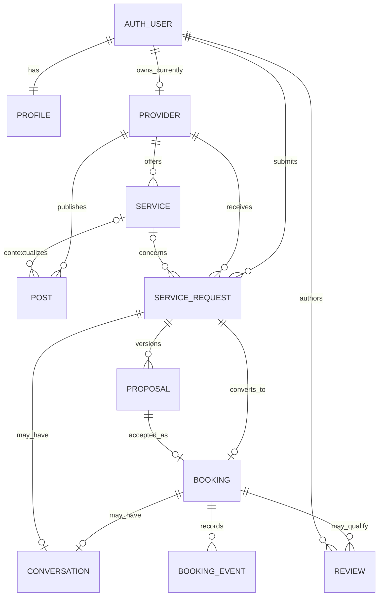
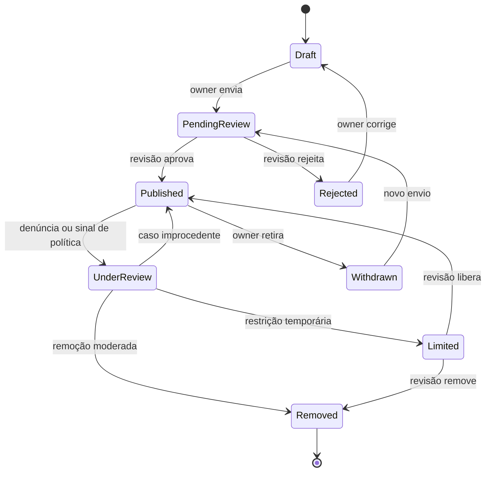
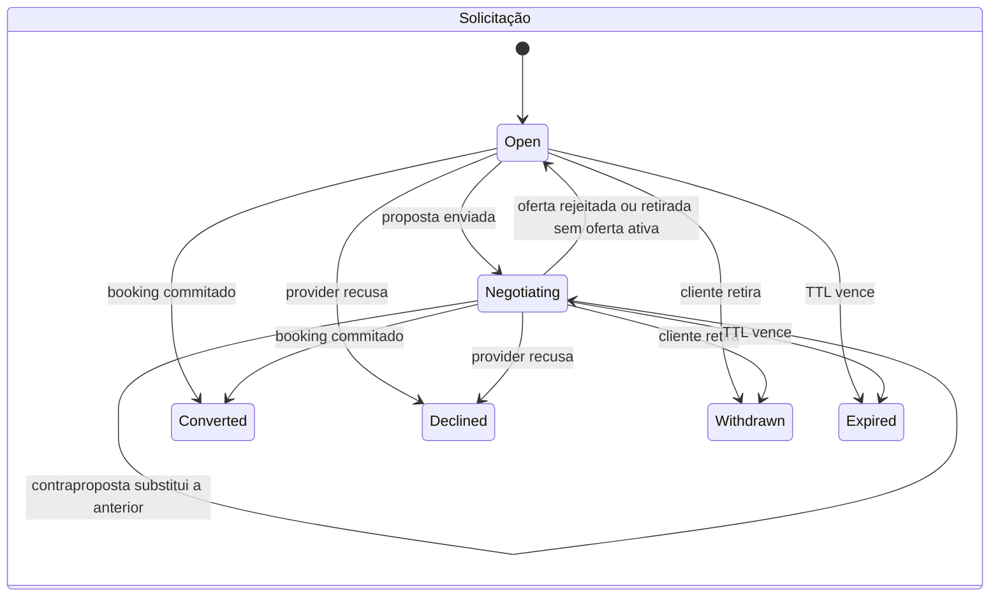
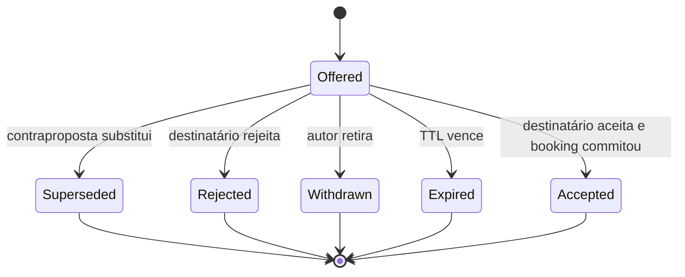
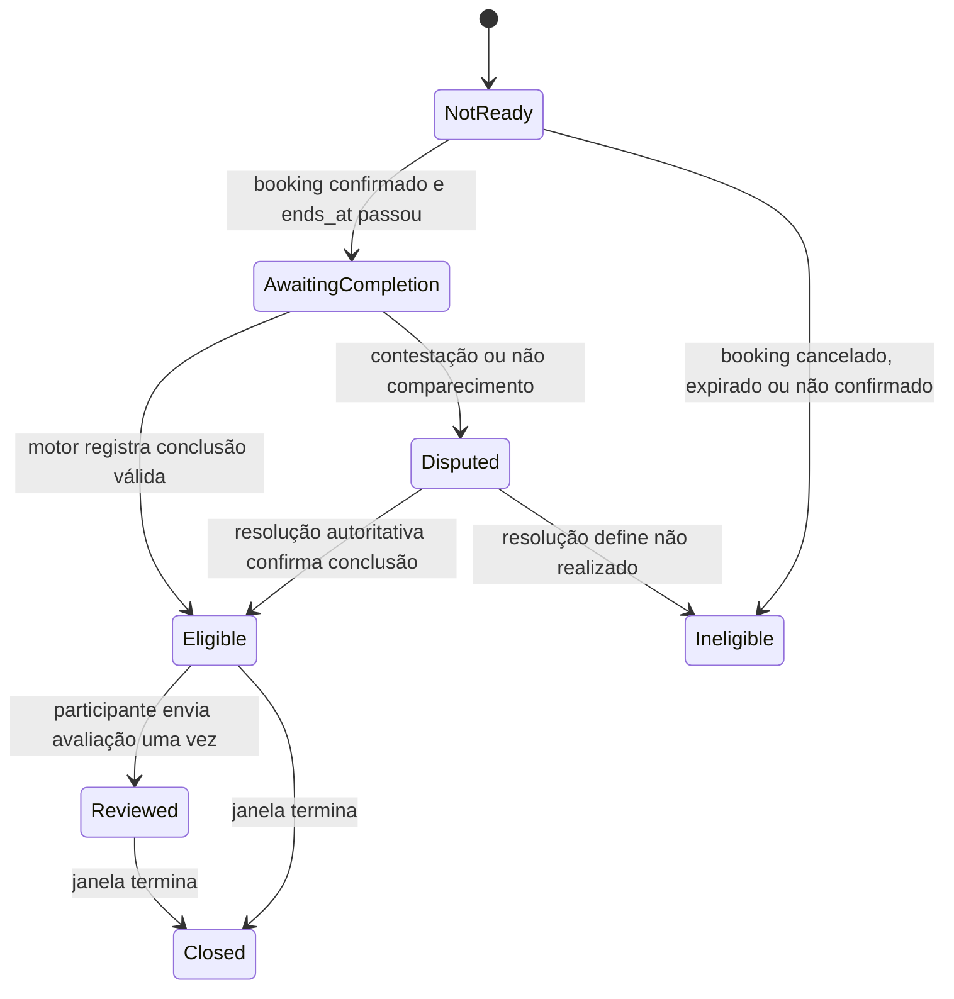
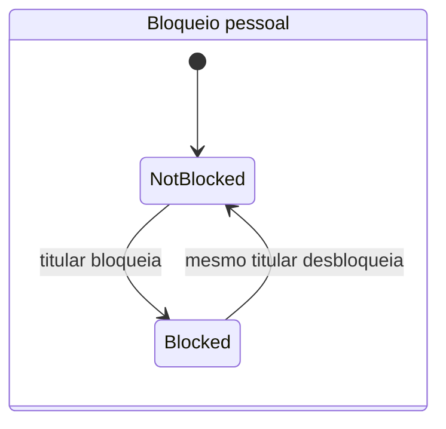
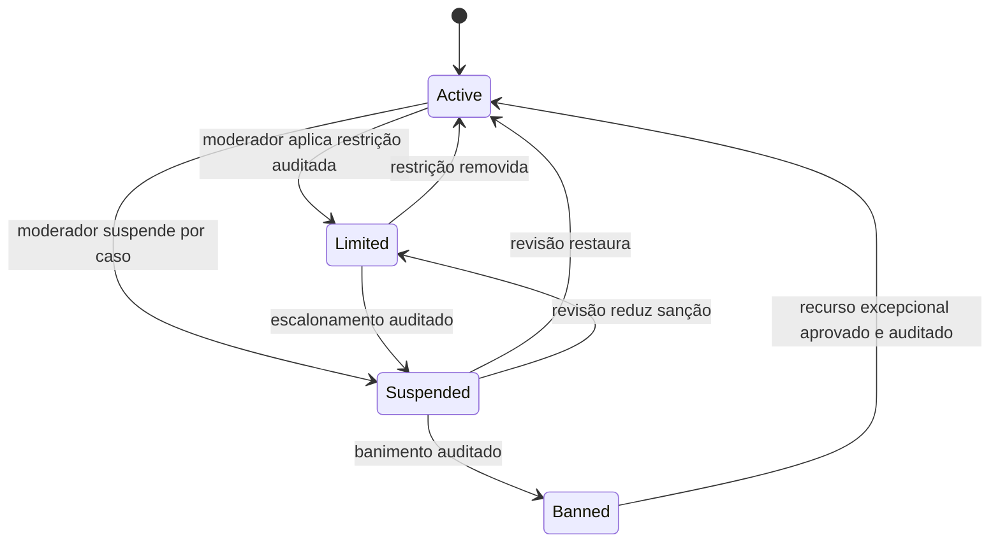
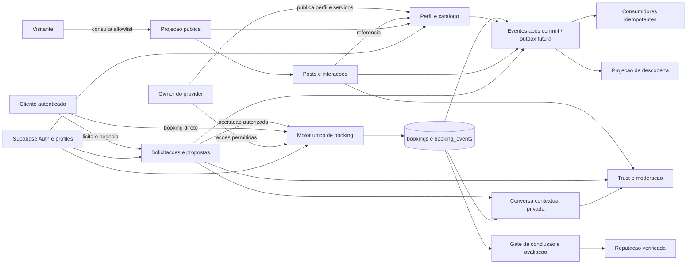

# Contrato de domínio e eventos — Marcou Social ↔ Agendamentos

- **Versão do contrato:** 1.0
- **Status:** fundação documental para #81; não representa schema, RPC, feed ou integração já implementados.
- **Revisado em:** 23/11/2026
- **Issues:** [#81](https://github.com/deividjmoura/marcou/issues/81) · Epic [#73](https://github.com/deividjmoura/marcou/issues/73) · roadmap [#72](https://github.com/deividjmoura/marcou/issues/72)
- **Base arquitetural:** ADR/roadmap de [#80](https://github.com/deividjmoura/marcou/issues/80), registrado pela [PR #113 (mergeada)](https://github.com/deividjmoura/marcou/pull/113).

Este contrato fixa fronteiras, invariantes e formatos conceituais para as próximas entregas. Os nomes de novas entidades e eventos são nomes de domínio, não uma proposta de migration executável. O estado implementado continua sendo o das migrations e do código atuais, referidos como **Atual**; comportamentos futuros estão marcados como **Contrato futuro**.

## 0. Invariantes não negociáveis

1. **Marcou é canônico.** A arquitetura continua Next.js + TypeScript + Supabase Auth/PostgreSQL/Storage + RLS. Não há Firebase, Vite ou uma API paralela.
2. **Uma identidade.** `auth.users.id` identifica a pessoa. A mesma conta pode atuar como cliente e profissional; papéis, IDs, ownership e visibilidade nunca são aceitos como autoridade só porque vieram do navegador.
3. **Um único motor de booking.** O núcleo atual é a autoridade para disponibilidade, concorrência, preço/duração capturados, expiração e estado da reserva. Solicitação, proposta, post, notificação e conversa não reservam horário nem criam um estado de booking paralelo.
4. **Escrita sensível no servidor e no banco.** Autorização server-side e RLS são defesa em profundidade. Estados, snapshots, contadores e projeções são calculados por código confiável.
5. **Privacidade por projeção.** Endereço completo, telefone, mensagens e documentos não aparecem em consultas públicas, payloads de eventos ou logs comuns. Consultas públicas retornam uma allowlist, nunca uma linha privada inteira.
6. **Sem efeito externo dentro da transação de booking.** Uma reserva só é confirmada pelo motor; entrega de notificação, índice ou integração é derivada e idempotente.
7. **Sem alteração nesta entrega.** Este arquivo é documental: não cria migrations, tabelas, RPCs, telas, integrações nem muda Supabase remoto, Netlify ou produção.

## 1. Glossário e bounded contexts

### 1.1 Glossário

| Termo | Definição neste contrato |
|---|---|
| **Conta / ator** | Identidade Supabase (`auth.users.id`) que inicia uma operação. Uma conta pode agir em diferentes capacidades, mas cada comando valida sua autorização no servidor. |
| **Perfil de conta** | Dados de uma pessoa em `profiles`; são privados por padrão. Não é sinônimo da página profissional pública. |
| **Perfil profissional / provider** | Página e negócio de um profissional, identificado por `providerId`; hoje `providers.owner_id` liga um provider a uma conta. A página pública desse perfil é uma **rota interna da aplicação**, canonicamente `/p/{slug}` — não é um site, subdomínio ou aplicação independente (decisão em [REVISAO-ARQUITETURA-SOCIAL.md](REVISAO-ARQUITETURA-SOCIAL.md)). |
| **Serviço** | Oferta de um provider. O serviço ativo é a origem atual de preço, duração, sinal e intervalo usados pelo motor. |
| **Publicação / conteúdo** | Perfil, serviço, post, mídia ou avaliação que pode passar por rascunho, moderação e projeção pública. Estar armazenado não significa estar publicado. |
| **Projeção pública** | Resposta montada com campos explicitamente permitidos para visitante. Não é `SELECT *` de uma tabela com RLS por linha. |
| **Solicitação** | Pedido contextual de orçamento/contratação enviado por um cliente a um provider. Não é booking, não garante preço e não bloqueia um slot. |
| **Proposta** | Oferta imutável de termos dentro de uma solicitação. Uma contraproposta cria uma nova revisão e referencia a oferta substituída; não edita o histórico. |
| **Participante** | Cliente ou proprietário do provider associado à solicitação, conversa ou booking específico. Seguidor, funcionário não autorizado ou outro provider não é participante por associação. |
| **Booking / reserva** | Compromisso persistido por operação do motor atual, associado a cliente, provider e serviço, com snapshot e estado próprios. |
| **Conclusão** | Resultado de prestação do serviço decidido por regra do domínio de booking. A passagem do horário, sozinha, não é prova de conclusão. |
| **Evento de domínio** | Registro interno e versionado de um fato que já foi confirmado na transação de seu agregado. Evento não é comando nem API pública. |
| **Outbox** | Registro transacional futuro para publicar eventos após commit. A entrega pode repetir; não promete “exactly once”. |
| **Admin auditado** | Moderador/administrador com permissão explícita, escopo de caso, menor privilégio e trilha de auditoria. Não é um papel vindo de formulário nem um bypass geral de RLS. |

### 1.2 Limites dos domínios

| Bounded context | Responsável pelo dado/decisão | Limite de integração |
|---|---|---|
| **Identidade** | Supabase Auth e `profiles` | Auth prova a sessão. `profiles` guarda dados privados mínimos; não publica telefone ou e-mail. |
| **Perfil profissional e catálogo** | Provider dono; `providers`, `services` e disponibilidade atuais | Só o dono altera seu provider e seus serviços. A projeção pública é uma allowlist. O catálogo atual alimenta o motor, não o post. |
| **Social e publicação** | Domínio social futuro | Posts, relações e estados de moderação têm ciclo próprio. Um post pode referenciar um serviço do mesmo provider, mas não define preço nem disponibilidade. |
| **Solicitações e propostas** | Domínio futuro de contratação | Registra intenção e negociação; termos aceitos só viram compromisso quando o motor cria o booking. |
| **Booking e disponibilidade** | Motor atual: domínio puro, PostgreSQL/RPCs e `bookings` | É a única autoridade de conflito, hold, snapshot e estado. Não recebe preço/estado confiável do cliente. |
| **Conversas** | Domínio futuro de comunicação | Conversa nasce de uma solicitação ou booking e é limitada aos participantes desse contexto; mensagem nunca é comando de booking. |
| **Reputação** | Avaliações futuras ligadas a booking elegível | Elegibilidade deriva do resultado do booking. Likes, seguidores e textos de conversa não são reputação verificada. |
| **Trust & Safety** | Bloqueios, denúncias, casos e sanções futuros | Pode retirar conteúdo ou limitar interações; não reescreve nem cancela bookings por fora do motor. |
| **Notificações** | `notifications` atual e projeções futuras | Inbox é uma projeção para um destinatário, não fonte de verdade do fato notificado. |
| **Eventos e integrações** | Agregado de origem + outbox futura | O produtor grava o fato na mesma transação do estado. Consumidores consultam apenas projeções autorizadas. |

## 2. Fonte de verdade, proprietário e classificação dos dados

### 2.1 Classes de acesso

| Classe | Quem pode ler | Exemplos e regra |
|---|---|---|
| **Pública (allowlist)** | Qualquer visitante, apenas pelos campos publicados | Nome comercial, slug, bio profissional aprovada, serviço visível, área aproximada, post publicado e avaliação aprovada. O estado de publicação e a moderação são aplicados no servidor. |
| **Privada do proprietário** | Conta dona do dado | Perfil pessoal, telefone de conta, rascunhos, configurações do provider e dados de moderação próprios quando houver. Não se torna pública por estar relacionada a um provider. |
| **Participante** | Apenas os participantes daquele recurso e pelo propósito necessário | Solicitação, proposta, conversa, booking, snapshots, telefone capturado para a reserva e endereço operacional permitido pela seção 6. A autorização é por ID do recurso e participante, não apenas por papel global. |
| **Admin auditado** | Moderador designado para um caso e com acesso mínimo | Denúncia, evidência, nota de moderação e ação administrativa. A consulta exige motivo/caseId e é auditada; admin não ganha acesso irrestrito a mensagens, endereços ou documentos. |

**Proibição transversal:** telefone, endereço exato, conteúdo de mensagem e documentos (conteúdo, nome de arquivo sensível, identificador/chave de Storage, URL assinada ou bytes) nunca entram em projeção pública, evento de domínio, métrica ou log comum. UUIDs de recursos também não autorizam acesso. Eventos internos transportam somente IDs opacos de agregados/recursos e, quando necessário, destinatários para roteamento; nunca referência ou conteúdo de documento/arquivo.

### 2.2 Matriz de fonte de verdade

| Dado / entidade | Fonte de verdade e proprietário | Classe padrão | Regra de autoridade |
|---|---|---|---|
| Autenticação, e-mail e subject | Supabase Auth; sujeito é `auth.users.id` | Privada / admin auditado em suporte | Nenhum `userId` enviado pelo cliente substitui `auth.uid()`. E-mail não é identidade pública. |
| Perfil de conta | `profiles`, titular da conta | Privada do proprietário | `profiles.display_name` e `profiles.phone` não são perfil social público; RLS atual é por `id = auth.uid()`. |
| Provider / perfil profissional | `providers`, proprietário do provider | Pública apenas por allowlist quando publicado; demais campos privados do owner | `providers.is_published` é a publicação atual; slug, owner e vínculo não são permissão para editar outro provider. |
| Serviço | `services`, provider dono | Pública para serviço ativo de provider publicado; configuração completa privada ao owner | `duration_minutes`, `price_cents`, `deposit_cents`, `buffer_minutes` são lidos pelo motor e copiados para snapshot do booking. |
| Regras e exceções de agenda | `availability_rules`, `availability_exceptions`, provider dono | Disponibilidade projetada publicamente; gestão privada do owner | Agenda pública revela apenas regras/intervalos necessários para calcular slots, sem identidade do booking. Campo livre `note` não deve receber PII. |
| Localização/endereço | Dado do provider ou do cliente ligado a serviço/booking; repositório privado futuro | Privada do owner ou participante conforme §6 | Não existe fonte de verdade de endereço no schema atual. Área aproximada é projeção derivada; endereço exato não fica em linha legível publicamente. |
| Post e publicação | Domínio social futuro; autor profissional e política de moderação | Pública só quando publicado; rascunho/revisão privada | Estado, ownership e vínculo com serviço são validados no servidor. Texto/mídia públicos passam por política; Storage não determina publicação. |
| Mídia/documento/anexo | Metadados PostgreSQL + Supabase Storage privado; owner do recurso | Participante ou admin auditado conforme finalidade; nunca público por padrão | Validar ownership, tipo e tamanho; sem URL/chave de Storage em evento/log; não há pipeline social de mídia implementado ainda. |
| Solicitação e propostas | Domínio futuro de negociação; cliente e provider da solicitação | Participante | Solicitação/proposta não é disponibilidade, preço capturado nem reserva. Uma revisão de proposta é imutável. |
| Conversa e mensagem | Domínio futuro de conversa; participantes do contexto | Participante; auditoria administrativa apenas por caso | O texto é dado privado; não copiar snippets, anexos ou corpo para eventos/notificações/logs. |
| Booking e transições | `bookings`, RPCs do motor e `booking_events`; motor de reservas | Participante | Banco calcula conflito, snapshot, estado, expiração e autorização. Nenhuma tabela social replica estado de booking. |
| Avaliação e reputação | Avaliação futura vinculada a booking elegível; autor é um participante | Privada até passar pela publicação/moderação; depois allowlist pública | Unicidade por booking, autor e alvo; agregados são derivados de avaliações publicáveis, nunca do cliente. |
| Bloqueio, denúncia e suspensão | Domínio Trust & Safety futuro; autor da ação e moderador responsável | Admin auditado; bloqueio visível somente ao necessário | Bloqueio pessoal é distinto de sanção da plataforma; ambos são aplicados no servidor. |
| Notificação | `notifications`, com `recipient_id` como proprietário | Privada do destinatário | Derivada de evento; leitura/marcação de leitura não altera o agregado de origem. |
| Evento/outbox | Registro imutável derivado do agregado de origem; produtor é o contexto que confirmou a transação | Interna; consumidor autorizado | Nunca é fonte concorrente de preço, estado, identidade ou disponibilidade; envelope não transporta conteúdo privado. |
| Contadores e descoberta | Projeções derivadas dos agregados | Pública somente em forma aprovada | Contadores são recontáveis; não confiar em valores enviados pelo navegador nem usar popularidade como elegibilidade. |

### 2.3 Regra para consultas públicas

RLS atual protege **linhas**, não garante por si só uma projeção pública segura por coluna. Hoje as migrations permitem leitura de linhas de `providers` publicados e de `services` ativos desses providers; `availability_exceptions` também tem leitura para provider publicado. Portanto:

- novas consultas públicas devem usar seleção explícita de campos ou uma projeção/RPC dedicada; nunca `SELECT *` como contrato social;
- não adicionar telefone, endereço ou conteúdo privado a uma linha/tabela legível publicamente esperando que RLS por linha o esconda;
- `providers.display_name`, `slug`, `description` e dados de catálogo precisam ser tratados como públicos quando o provider está publicado; texto livre não deve conter PII. As migrations atuais não validam semanticamente que uma descrição omita telefone/endereço, portanto não afirmar que esse filtro já existe;
- `get_provider_schedule` é uma consulta de disponibilidade: pode retornar intervalos ocupados sem `bookingId`, cliente ou serviço identificável. Não é um feed de eventos. A RPC omite `availability_exceptions.note`, mas a tabela tem leitura pública por linha para providers publicados; enquanto não houver projeção/controle de coluna, trate `note` como público e nunca grave PII ali;
- a rotina de moderação deve retirar imediatamente da projeção itens não publicados, restritos, removidos ou de contas suspensas, inclusive em cache;
- a URL pública do perfil é rota interna **canônica `/p/{slug}`**, servida pela mesma aplicação que o restante da plataforma; nunca existe site, subdomínio, hospedagem ou aplicação independente por profissional. As alternativas `/{slug}`, `/@{slug}` e `/profissional/{slug}` foram avaliadas na [revisão de 27/11/2026](REVISAO-ARQUITETURA-SOCIAL.md) e permanecem rejeitadas ou adiadas; qualquer alias futuro deve reescrever internamente para a rota canônica, sem criar segunda URL canônica.

## 3. Entidades conceituais e relações

As cardinalidades abaixo são conceituais, não nomes ou constraints de schema. Os IDs são referências opacas; acesso sempre é revalidado no servidor.

- Uma conta tem um perfil de conta. Hoje há no máximo um provider por owner (`providers.owner_id` é único); a mesma conta pode ser cliente em outra contratação.
- Um provider possui serviços e conteúdos profissionais. Um post pode apontar para zero ou um serviço do mesmo provider; o vínculo dá contexto/CTA, não altera o serviço.
- Uma solicitação liga exatamente um cliente a um provider, podendo apontar para um serviço. A solicitação não cria hold. Cada contraproposta é uma nova proposta ligada à mesma solicitação e à versão anterior que substitui.
- Uma conversa é contextual a **uma** solicitação ou **um** booking, nunca a uma lista de participantes fornecida pelo cliente. Os participantes são derivados do agregado contextual.
- Um booking liga cliente, provider e serviço, preservando snapshots. Quando originado de proposta, pode manter uma referência de origem para auditoria; o booking continua sendo a única reserva.
- Uma avaliação liga um booking elegível, autor participante e alvo oposto. Uma conversa, post ou solicitação sem booking elegível não autoriza avaliação.



A relação da conversa com `SERVICE_REQUEST` **ou** `BOOKING` é exclusiva por conversa. O diagrama a desenha em duas linhas para mostrar os dois contextos possíveis; não significa que uma conversa receba ambos sem uma regra explícita de migração.

## 4. Máquinas de estado

### 4.1 Conteúdo, publicação e moderação

**Contrato futuro.** Aplica-se ao fluxo de publicação de perfil profissional, serviço social, post e avaliação. Não substitui silenciosamente as colunas atuais `providers.is_published` e `services.is_active`; o mapeamento e rollout são trabalho de schema posterior.

| Estado | Público? | Entrada / saída permitida |
|---|---:|---|
| `draft` | Não | Criado/alterado pelo owner autorizado. Pode ser enviado para revisão. |
| `pending_review` | Não | Submissão explícita. Revisor autorizado aprova ou rejeita; editar cria nova revisão e invalida a decisão anterior. |
| `published` | Sim, por allowlist | Somente depois de validações de ownership, campos públicos, política e aprovação exigida. |
| `under_review` | Não | Denúncia ou sinal de política remove a publicação da projeção enquanto o caso é analisado. |
| `limited` | Não por padrão | Restrição temporária de alcance/ações aplicada por moderador; não é um meio de manter conteúdo sensível público. |
| `rejected` | Não | Owner pode corrigir e reenviar como nova revisão. Não há republicação automática. |
| `withdrawn` | Não | Owner retira voluntariamente. Retornar exige novo envio/revisão. |
| `removed` | Não | Remoção moderada; terminal para aquela revisão, com trilha de auditoria e retenção conforme política. |

Regras: conteúdo criado é privado até publicação explícita; somente perfil profissional publica conteúdo público no beta inicial; edição de conteúdo publicado volta à validação/moderação; contadores e mídia nunca restauram visibilidade. Um bloqueio/suspensão também exclui conteúdo da projeção mesmo que o estado local permaneça `published`.



### 4.2 Solicitação, proposta e contraproposta

#### Solicitação

| Estado | Significado e transições |
|---|---|
| `open` | Solicitação válida e visível apenas aos participantes. Cliente pode retirar; provider pode recusar ou enviar uma proposta. |
| `negotiating` | Há uma proposta pendente. Uma contraproposta cria uma nova revisão e substitui a oferta anterior de forma atômica. |
| `converted` | Estado final somente quando a transação do motor criou o booking correspondente. |
| `declined` | Provider recusou; terminal, salvo novo pedido criado pelo cliente. |
| `withdrawn` | Cliente retirou; terminal. Não cancela um booking já criado. |
| `expired` | A solicitação venceu conforme TTL de produto configurado; terminal. Sem TTL configurado, não se oferece negociação sem prazo definido. |

#### Proposta / contraproposta

| Estado | Quem pode produzir / efeito |
|---|---|
| `offered` | Proposta imutável aguardando resposta do destinatário. Cada proposta tem um autor, destinatário, revisão e, se for contraproposta, referência à proposta substituída. |
| `accepted` | Só após aceitação autorizada **e commit bem-sucedido do booking** na mesma operação transacional. |
| `rejected` | Destinatário rejeitou. A solicitação pode voltar a `open` para nova oferta. |
| `superseded` | Outra contraproposta substituiu esta. Não pode ser aceita depois. |
| `withdrawn` | Autor retirou a oferta antes da resposta. |
| `expired` | Prazo da oferta terminou; não pode ser aceita. |

Invariantes de negociação:

- proposta aceita é uma revisão congelada; editar termos significa nova proposta;
- somente o destinatário aceita, rejeita ou contrapropõe; o autor não aceita a própria oferta;
- no caminho compatível atual, se o provider concordar com a contraproposta do cliente, deve emitir uma nova oferta final para o cliente confirmar; a contraproposta do cliente não é marcada como aceita nem convertida pelo provider;
- a contraproposta substitui a versão pendente dentro da mesma transação, sem duas ofertas simultaneamente aceitas;
- mensagem “aceito” em chat, clique no CTA ou atualização otimista da interface **não** é aceitação de domínio;
- se o motor detectar conflito, serviço inválido ou prazo vencido, a transação inteira falha: não deixa a proposta `accepted`, não cria reserva parcial e não libera slot por fora;
- TTL da solicitação/proposta é configuração obrigatória antes de habilitar o fluxo; sem valor/política aprovados, default é manter a funcionalidade desabilitada, não criar ofertas sem vencimento.





### 4.3 Conclusão e elegibilidade de avaliação

**Atual:** `booking_status` contém `pending_payment`, `pending_review`, `confirmed`, `cancelled` e `expired`; não há estado `completed`, tabela de avaliação ou regra de elegibilidade implementada. `confirmed` significa pagamento validado, não serviço realizado.

**Contrato futuro:** a elegibilidade é calculada por booking e por autor. Um booking cancelado/expirado ou não confirmado é inelegível; uma disputa/não comparecimento ainda não resolvido fica em `disputed`, sem avaliação elegível até resolução. Passar `ends_at` apenas permite iniciar a confirmação de conclusão; não cria avaliação elegível por relógio. O motor de booking registra o resultado conforme política aprovada; Trust & Safety pode suspender a elegibilidade durante disputa sem inventar um segundo estado de reserva.

| Estado de elegibilidade | Regra |
|---|---|
| `not_ready` | Serviço ainda não terminou, booking não está confirmado ou resultado não foi resolvido. Nenhuma avaliação pode ser criada. |
| `awaiting_completion` | Booking confirmado e `ends_at` passou; aguarda a regra autoritativa de conclusão. Ainda não é avaliável. |
| `eligible` | O motor registrou conclusão válida conforme política vigente. Cada participante pode avaliar o outro uma vez, dentro da janela definida. |
| `disputed` | Não comparecimento, contestação ou denúncia relevante pendente. Suspende novas avaliações/publicação conforme política; preserva auditoria. |
| `ineligible` | Resultado definido como cancelado, expirado ou não realizado. Estado terminal para avaliação daquele booking. |
| `reviewed` | Estado por autor/alvo depois de uma avaliação submetida. A outra parte pode continuar elegível, se a política permitir avaliação mútua. |
| `closed` | Janela de avaliação encerrada. Avaliação tardia não é aceita sem exceção administrativa auditada. |

A avaliação é única por `(booking, autor, alvo)`, não pode avaliar a si próprio e não pode ser reatribuída pelo avaliado. O texto de avaliação segue a máquina de moderação de conteúdo; avaliações não aprovadas não entram em agregados públicos. Até #25/#102 fixarem conclusão, ausência e janela, o default seguro é **não habilitar avaliações** e não inferir conclusão de `confirmed` ou da data/hora.



`Reviewed` é o estado da elegibilidade de **um autor**; não consome automaticamente a elegibilidade do outro participante. O resultado de disputa e a confirmação de conclusão pertencem ao booking/Trust & Safety, nunca ao conteúdo social.

### 4.4 Bloqueio e suspensão

Bloqueio entre pessoas e suspensão de conta/provider são conceitos separados.

| Máquina | Estados/transições | Efeito padrão |
|---|---|---|
| **Bloqueio pessoal direcional** | `not_blocked → blocked` pelo titular; `blocked → not_blocked` somente pelo mesmo titular | Aplicado dos dois lados às superfícies sociais: não seguir, reagir, comentar, iniciar/enviar conversa nem criar nova solicitação entre as partes. Não cancela, apaga ou altera booking existente. Caminhos necessários para gerir reserva ativa, denunciar ou obter suporte permanecem sujeitos a autorização. |
| **Sanção da plataforma** | `active → limited → suspended → active` por decisão auditada; `suspended → banned` ou reversão após recurso | `limited` restringe ações explicitamente; `suspended` remove publicações da projeção e bloqueia novas publicações/solicitações; `banned` impede novas atividades. A decisão exige caso, ator moderador, escopo, motivo restrito, instante e, quando aplicável, expiração/recurso. |

Uma sanção não edita, cancela nem confirma reservas existentes. Risco de segurança pode limitar mensagens e acesso ao endereço conforme decisão de caso, sem revogar os direitos de leitura/gestão que a política de booking exige. Ações administrativas sobre booking continuam passando pelas operações autorizadas do motor.





## 5. Matriz de autorização por ator e operação

A autorização é sobre o recurso específico e revalidada a cada leitura/escrita. `Cliente` e `provider owner` são capacidades da mesma conta, não papéis mutuamente exclusivos. `Participante` significa cliente ou owner do provider daquele recurso. A chave `service_role` contorna RLS: só pode existir em código/job server-side secreto e restrito, nunca em browser, fallback de autorização ou impersonação de usuário.

| Operação | Visitante | Cliente autenticado | Owner do provider | Participante do recurso | Admin/moderador | Worker de sistema |
|---|---|---|---|---|---|---|
| Ler perfil/serviço/post publicado e projeção segura de agenda | Sim, allowlist e estado publicado | Sim | Sim; owner também vê seus rascunhos | Sim, se já tiver acesso ao recurso | Apenas para caso/moderação necessário, auditado | Só projeção/escopo explicitamente concedido |
| Ler ou alterar `profiles` | Não | Apenas a própria linha | Apenas sua própria linha de conta | Não ganha acesso ao perfil pessoal da outra parte | Não por padrão; suporte justificado e auditado | Não por padrão |
| Criar/alterar provider, serviço e regras de agenda | Não | Não por ser apenas cliente | Apenas provider(s) de sua propriedade; hoje no máximo um | Não por ser participante de booking | Moderação pode ocultar, não editar catálogo/preço no lugar do owner | Nenhuma escrita genérica |
| Publicar post, reagir, seguir, comentar ou salvar | Não | Sim, em recurso permitido e sem bloqueio/suspensão | Sim em nome da identidade autorizada; publicação profissional só no beta | Não ganha permissão extra por reserva | Remover/restringir conteúdo via caso auditado | Projeção/cache somente; sem criar interação em nome de usuário |
| Criar/retirar solicitação | Não | Criar como cliente autenticado; retirar somente a própria | Não cria solicitação em nome do cliente; recebe as direcionadas a seus providers | Apenas o cliente da solicitação retira; provider pode recusar | Pode aplicar restrição por caso, não negociar | Nenhuma decisão de negócio |
| Enviar/contrapropor/aceitar proposta | Não | Somente parte daquela solicitação e respeitando papel de emissor/destinatário | Somente parte daquela solicitação | Apenas destinatário aceita/rejeita; emissor não aceita a própria proposta | Não pode aceitar ou alterar termos em nome das partes | Expiração/projeções somente via comando autorizado; nunca aceita oferta implicitamente |
| Ler solicitação, proposta, conversa, telefone ou endereço exato | Não | Só se participante daquele recurso e conforme §6 | Só se participante daquele recurso e conforme §6 | Sim, no escopo do recurso | Somente caso e campo estritamente necessários, com auditoria; acesso ao conteúdo não é automático | Sem acesso amplo; payload mínimo e consultas de sistema limitadas |
| Enviar mensagem | Não | Somente participante ativo, sem bloqueio/suspensão e dentro da conversa | Mesma regra | Sim, apenas no contexto autorizado | Não envia como usuário; pode aplicar restrição e preservar evidência por caso | Não envia mensagem de usuário; notificação é separada e genérica |
| Criar booking direto | Não | Sim, como cliente, via operação do motor | Não pode forjar `customer_id`; pode atuar como cliente se reservar para si pelas mesmas regras | O provider não cria reserva em nome de outro cliente | Não cria nem confirma reserva por fora do motor | Apenas rotina explicitamente autorizada; nunca escrita genérica por `service_role` |
| Transicionar booking | Não | Participante: comprovante ou cancelamento conforme regra atual | Owner pode registrar comprovante, aprovar sinal, cancelar ou expirar somente conforme regra atual | Participante não significa qualquer transição: o motor valida evento e ator | Sem bypass; incidente/ajuste exige operação auditada do motor | Cron/RPC restrito pode expirar/lembretes; papel não autoriza alteração arbitrária |
| Ler booking/evento/notificação | Não | Próprios bookings e notificações | Bookings do provider próprio; notificações próprias | Apenas linha ligada ao participante | Auditoria de booking só quando necessária e autorizada; notificação não concede acesso ao alvo | Apenas tarefa específica; nenhuma leitura para analytics comum |
| Criar avaliação | Não | Somente após elegibilidade daquele booking; uma por alvo | Mesma regra como participante | Não por post, follow, mensagem ou solicitação | Moderar/publicar/reter por política; não avaliar em nome das partes | Atualizar projeções de avaliações aprovadas, sem inventar elegibilidade |
| Aplicar bloqueio/denúncia ou suspensão | Não | Bloquear/denunciar em seu próprio nome | Mesma capacidade de conta | Não bloquear em nome do outro participante | Aplicar sanção apenas com permissão/caso e trilha de auditoria | Enforcements derivados de estado autoritativo, sem auto-suspender por contagem não verificada |

**Casos negativos obrigatórios antes de cada módulo:**

1. Um usuário não lê/edita a linha de `profiles`, booking, solicitação, conversa ou notificação de outro usuário só por conhecer o UUID.
2. Owner A não altera provider, serviço ou agenda B; `serviceId` deve pertencer ao `providerId` resolvido pelo servidor.
3. `owner_id`, `customer_id`, papel, visibilidade, preço, duração, estado, contador ou `recipient_id` enviado pelo cliente é ignorado/rejeitado como autoridade.
4. Visitante não lê telefone, mensagem, documento, endereço, dados de participante ou colunas privadas por uma consulta direta a tabela pública.
5. Seguir/curtir/comentar/receber uma notificação não dá acesso a booking ou conversa.
6. Cliente não aprova o próprio pagamento; provider não aceita proposta que ele mesmo enviou; outra conta não faz replay de idempotency key para obter um booking.
7. Evento `proposal.accepted` não é comando para criar uma reserva; um consumidor de evento não pode escrever `bookings` diretamente.
8. Moderador/admin não ganha `service_role`, impersonação de `auth.uid()` ou leitura irrestrita de conteúdo/endereço por estar autenticado no painel.
9. Estado `published` não sobrepõe bloqueio, suspensão, remoção ou falta de vínculo entre post/serviço/provider.
10. Nenhum cliente faz `INSERT/UPDATE/DELETE` direto em `bookings` ou `booking_events`; criação/transição passa pelas operações do motor e respectivas regras de privilégio.

## 6. Revelação de modalidade, local e endereço

| Momento | Informação permitida |
|---|---|
| Descoberta pública | Apenas modalidade e área aproximada (por exemplo, cidade/região escolhida pelo profissional). Nunca rua, número, complemento, coordenada precisa, instrução de acesso ou localização residencial. |
| Post, comentário, portfólio e serviço público | Não publicar endereço residencial, telefone privado, link de mapa com coordenada precisa ou instrução de acesso. Texto livre passa por validação/moderação; se revelar PII, não é publicado até saneamento. |
| Solicitação antes do booking | Coletar somente área aproximada e modalidade. O default é não solicitar endereço exato nem anexar documento para pedir orçamento. Uma necessidade de pré-visita exige decisão de produto/privacidade, finalidade explícita, consentimento e acesso limitado aos participantes daquele pedido. |
| Reserva pendente (`pending_payment` / `pending_review`) | Não revelar endereço exato como parte da projeção pública ou de evento. Acesso operacional antecipado só poderá ser uma exceção de produto documentada, com propósito e autorização explícitos; default é oculto até confirmação. |
| Booking `confirmed` | Se a modalidade exigir deslocamento, endereço exato pode ser recuperado somente pelos participantes daquele booking e apenas para execução do serviço. Mostrar o mínimo necessário, no contexto protegido; nunca numa página pública ou endpoint de busca. |
| Booking cancelado/expirado ou sanção de segurança | Revogar a autorização para novas leituras do endereço e invalidar links temporários. Retenção e tratamento de informação já vista dependem da política legal/operacional; não prometer que um dado já revelado pode ser “desvisto”. |

Regras de implementação futura: endereço exato fica em armazenamento/coluna de acesso privado separado de `providers` e de qualquer tabela cuja leitura pública seja por linha; URL assinada é curta, destinatário e booking são verificados no servidor; acesso excepcional de admin é break-glass auditado. Não colocar endereço em `availability_exceptions.note`, descrição de serviço, texto de evento, notificação, métrica ou log. Telefone de `profiles` e `bookings.customer_phone` permanece privado/participante; o fluxo de booking atual pode armazenar telefone no snapshot da reserva, mas isso não o torna público.

## 7. Catálogo inicial de eventos

### 7.1 Envelope e versionamento

Eventos abaixo são contratos **internos**, não webhooks públicos. O envelope futuro recomendado é:

```json
{
  "eventId": "uuid",
  "eventType": "booking.created",
  "schemaVersion": 1,
  "occurredAt": "2026-11-23T12:00:00Z",
  "producer": "booking-core",
  "aggregateType": "booking",
  "aggregateId": "uuid",
  "aggregateVersion": 1,
  "actor": { "type": "user", "id": "uuid" },
  "correlationId": "uuid",
  "idempotencyKey": "opaque-stable-key",
  "data": { "bookingId": "uuid" }
}
```

`schemaVersion: 1` é a versão do formato do evento, não uma declaração de que esse envelope já está persistido. `occurredAt` é UTC; `aggregateVersion` cresce por agregado; `actor.id` pode ser nulo para rotina de sistema e nunca substitui autorização. Campos opcionais podem ser adicionados sem mudar o sentido de v1; alteração incompatível cria v2/nova versão e período de coexistência. Consumidor que não entende versão não deve adivinhar semântica: estaciona/quarentena e alerta.

**Proibido em todas as linhas da tabela:** nome/telefone/e-mail, endereço ou coordenada precisa, texto de mensagem/comentário/proposta/denúncia/avaliação, bytes/metadados sensíveis de documento, chave de Storage, URL assinada, comprovante, token, segredo ou texto livre de motivo. O payload carrega IDs e estado mínimo; consumidores obtêm detalhes por caminho autorizado. Eventos de moderação podem carregar `caseId` e IDs opacos de recurso, nunca a denúncia/evidência em si.

| Evento / versão | Emissor | Consumidor esperado | Payload mínimo v1 | Proibição específica adicional | Chave de idempotência do produtor |
|---|---|---|---|---|---|
| `profile.publication_changed` v1 — futuro | Contexto de perfil, na transação de publicação | Projeção de descoberta, feed/cache e invalidação de URL | `providerId`, `publicationState`, `aggregateVersion` | Bio, telefone, endereço, nome civil e campos ainda não allowlisted | `provider:{providerId}:publication:{aggregateVersion}` |
| `service.catalog_changed` v1 — futuro | Catálogo, após validação do owner | Busca/catálogo social; booking revalida o serviço na própria operação | `providerId`, `serviceId`, `aggregateVersion`, `bookable` | Preço, duração, depósito e texto do serviço no evento; obtê-los da projeção autorizada | `service:{serviceId}:catalog:{aggregateVersion}` |
| `post.publication_changed` v1 — futuro | Social/moderação, no commit de mudança pública | Feed, projeção pública, cache e fila de moderação | `postId`, `providerId`, `publicationState`, `aggregateVersion` | Corpo, comentário, mídia, key/URL de arquivo e local | `post:{postId}:publication:{aggregateVersion}` |
| `service_request.created` v1 — futuro | Solicitações, na criação autorizada | Inbox do provider e notificação privada ao destinatário | `requestId`, `providerId`, `recipientId`, `aggregateVersion` | Escopo livre, telefone, endereço, disponibilidade exata e anexos | `request:{requestId}:created` |
| `proposal.offered` v1 — futuro | Solicitações, na inclusão imutável de proposta/contraproposta | Inbox/notificação privada e projeção da negociação | `requestId`, `proposalId`, `recipientId`, `revision`, `aggregateVersion` | Preço/termos livres, mensagem, contato, endereço e anexos | `proposal:{proposalId}:offered` |
| `proposal.accepted` v1 — futuro | **Booking core**, somente na transação que cria o booking | Notificação dos participantes, timeline de pedido e reconciliação | `requestId`, `proposalId`, `bookingId`, `aggregateVersion` | Termos/snapshot e dados de cliente; consumidor lê booking apenas como participante | `proposal:{proposalId}:accepted` com unicidade de conversão por `proposalId` |
| `proposal.declined` v1 — futuro | Solicitações, resposta autorizada do destinatário | Inbox/timeline privada; eventualmente pedido volta a `open` | `requestId`, `proposalId`, `aggregateVersion` | Razão livre, texto de conversa e dados privados | `proposal:{proposalId}:declined` |
| `conversation.message_created` v1 — futuro | Conversas, após checar participante e bloqueio | Badge/inbox de participantes e entrega realtime autorizada | `conversationId`, `messageId`, `recipientIds`, `aggregateVersion` | Corpo, trecho, telefone, endereço, nome de arquivo e conteúdo de anexo | `message:{messageId}:created` |
| `booking.created` v1 — atual, envelope futuro | RPC `create_booking` no motor; fato atual em `booking_events` | Trigger de notificações e projeções autorizadas de agenda | `bookingId`, `status=pending_payment`, `eventId` | `customer_name`, `customer_phone`, endereço, payload de formulário e preço no evento | Comando atual: `source + external_event_id`; entrega: `booking_events.id` |
| `booking.proof_received` v1 — atual | RPC `transition_booking` no motor | Notificação privada ao provider e estado do booking | `bookingId`, `status=pending_review`, `eventId` | Documento/comprovante, telefone, mensagem ou link de arquivo | Chave da operação em `booking_events.external_event_id`; entrega por `eventId` |
| `booking.confirmed` v1 — atual | RPC `transition_booking` após aprovação permitida | Notificações dos participantes e projeção de agenda | `bookingId`, `status=confirmed`, `eventId` | Dados de pagamento, contato, endereço e snapshots integrais | Chave da operação em `booking_events.external_event_id`; entrega por `eventId` |
| `booking.cancelled` v1 — atual | RPC `transition_booking` após autorização | Notificações dos participantes e projeção de agenda | `bookingId`, `status=cancelled`, `eventId` | Motivo livre, telefone, endereço, conversa e dados de reembolso | Chave da operação em `booking_events.external_event_id`; entrega por `eventId` |
| `booking.expired` v1 — atual | Motor ou rotina autorizada de expiração | Notificações privadas e projeção de agenda | `bookingId`, `status=expired`, `eventId` | Dados pessoais, motivo de entrada, endereço e snapshots completos | Atual: `system-expire-{bookingId}` ou chave equivalente; entrega por `eventId` |
| `booking.reminder` v1 — atual | `create_booking_reminders` no banco | Notificação privada de cada participante | `bookingId`, `eventId`, janela/tipo do lembrete | Telefone, endereço, corpo de mensagem ou identificadores externos de calendário | Atual: `reminder-{bookingId}-{YYYYMMDD}`; notificação usa `eventId` |
| `booking.completion_resolved` v1 — futuro | Booking core, depois de conclusão resolvida pela política | Gate de elegibilidade de avaliação e métricas de contratação | `bookingId`, `completionState` (`completed` ou `not_completed`), `aggregateVersion` | Relato de no-show, disputa, texto ou evidência | `booking:{bookingId}:completion:{aggregateVersion}` |
| `review.created` v1 — futuro | Reputação, depois de verificar booking e unicidade | Moderação, projeção de reputação e notificação genérica | `reviewId`, `bookingId`, `targetId`, `aggregateVersion` | Nota/texto da avaliação e identidade de contato | `review:{reviewId}:created`; constraint por booking/autor/alvo |
| `trust.block_changed` v1 — futuro | Trust & Safety, após autorização do titular | Filtros de feed, busca, comentários e conversa | `actorId`, `subjectId`, `blockState`, `aggregateVersion` | Motivo, conversa, localização ou dados do caso | `block:{actorId}:{subjectId}:{aggregateVersion}` |
| `moderation.action_applied` v1 — futuro | Serviço de moderação após decisão auditada | Projeções de conteúdo, enforcement e auditoria restrita | `caseId`, `subjectType`, `subjectId`, `action`, `aggregateVersion` | Denúncia, evidência, nota, mensagem, documento ou endereço | `moderation:{caseId}:{aggregateVersion}` |

**Compatibilidade com os nomes atuais:** `booking_events` grava hoje `booking.created`, `booking.proof_received`, `booking.confirmed`, `booking.cancelled`, `booking.expired` e `booking.reminder`. A entrada `payment_approved` de `transition_booking` resulta em `booking.confirmed`; não se deve inventar um segundo estado/evento de aprovação em consumidor. `booking.changed` existe hoje como `notification_kind`, mas as migrations atuais não o emitem como evento de domínio; não tratá-lo como fato publicado até haver produtor explícito. `payload_version` atual de `booking_events` não equivale ao envelope completo acima.

## 8. Outbox e consumidores idempotentes

### 8.1 Situação atual e evolução

- **Atual:** `booking_events` é trilha de auditoria do motor, com `event_type`, ator/origem, `external_event_id`, versão do payload e instante. Sua chave única atual é `(source, external_event_id)` quando há uma chave não nula. Não contém o envelope nem metadados de tentativas/lease de publicação.
- **Atual:** a migration de notificações usa trigger `AFTER INSERT` em `booking_events` para gerar `notifications`; `event_key` é o ID do evento e há unicidade `(recipient_id, event_key)`. A notificação é privada do destinatário e sua origem continua sendo booking.
- **Contrato futuro:** eventos sociais devem ser gravados em uma outbox PostgreSQL **na mesma transação** que altera o agregado de origem. A implementação/schema pertencem a #82 ou às issues de domínio correspondentes. Não assumir que `booking_events` já é uma outbox genérica nem usá-la para guardar corpo de post/mensagem.

A migration atual comenta que falha ao gerar notificação não deve impedir a operação, mas `notify_on_booking_event()` não captura exceções no corpo do trigger. No PostgreSQL, uma exceção não tratada do trigger pode abortar a transação que o disparou. Portanto, o comportamento atual é transacional, não um mecanismo “fail-open” comprovado. Antes de depender de notificações desacopladas, testar falha de inserção e decidir, em #26/#82, se o efeito precisa de outbox/retry separado.

### 8.2 Regras de publicação e consumo

1. A gravação do agregado e do evento é atômica. Não publicar evento se a transação de origem fizer rollback.
2. A publicação externa acontece depois do commit, nunca segurando lock de booking durante I/O de rede.
3. A entrega é **at least once**. O consumidor usa `eventId` como dedupe e grava sua inbox/receipt na mesma transação do efeito local; projeções usam upsert por recurso e versão.
4. `idempotencyKey` impede duplicação da operação de origem; `eventId` impede repetição do consumo. São chaves distintas. Escopo da chave inclui agregado/operação/ator autorizado; chave reaproveitada por outro ator ou outro recurso falha fechada.
5. Consumidores rejeitam versão incompatível, ignoram versão antiga do agregado e conseguem reprocessar o mesmo `eventId` sem duplicar notificação, índice ou contagem.
6. Worker reivindica lote com lease/lock curto (por exemplo, `FOR UPDATE SKIP LOCKED`), registra tentativas e agenda retry com backoff. Depois do limite, estaciona em dead-letter/quarentena com alerta e reprocessamento auditado; não perde o evento nem bloqueia a escrita de booking.
7. Não manter lock durante chamada externa. E-mail, push ou realtime recebem apenas destinatários/IDs mínimos; a mensagem é montada pela projeção privada autorizada, não por snippet no evento.
8. Logs comuns guardam tipo, `eventId`, duração, status/código e correlation ID. Nunca guardam payload bruto, headers secretos, nome/e-mail/telefone, conteúdo de mensagem/documento, endereço ou URL/identificador de arquivo.
9. Eventos são internos e não substituem query autorizada. Consumidor de `booking.created`/`proposal.accepted` não cria nem altera booking; o evento só informa um commit concluído.

## 9. Conversão de proposta aceita em booking

Uma aceitação só se torna compromisso se o motor criar a reserva. **Não** inserir em `bookings` a partir da tela, de um trigger social ou de um consumidor assíncrono.

### 9.1 Garantias atuais e caminho compatível

A RPC atual `create_booking` recebe slug do provider, `serviceId`, início escolhido, nome/telefone do cliente e chave de idempotência; resolve provider e serviço no banco, exige provider publicado e serviço ativo, revalida disponibilidade, serializa concorrência por provider, expira holds vencidos conflitantes, cria `pending_payment`, captura snapshots de serviço, define `expires_at`, registra `booking.created` e deixa a constraint GiST ser a garantia final contra sobreposição. O cliente não passa preço, duração ou status autoritativos.

Para uma conversão compatível, a proposta deve apontar para um serviço ativo e seus termos devem coincidir com os valores que o serviço fornece no instante da criação. Preço/duração vêm do serviço no banco, não do post ou da proposta enviada pelo navegador. Se os termos divergirem, a operação falha e exige proposta/serviço coerente — não se “corrige” o snapshot no cliente.

A RPC atual, isoladamente, não conhece `proposalId` e não atualiza solicitação/proposta na mesma transação. Portanto, ela preserva todas as garantias para booking direto, mas **não basta para declarar a conversão de uma proposta como atômica**. Para esse caso, um comando do booking core deve envolver/reutilizar a operação atual e, na mesma transação, associar a proposta e mudar os estados. Até essa integração existir, não marcar proposta como `accepted` nem emitir `proposal.accepted`; um fluxo sem proposta pode continuar usando o booking direto atual.

### 9.2 Comando transacional para conversão

O contrato futuro é um comando do motor, por exemplo `create_booking_from_proposal(proposalId, idempotencyKey)`, não um endpoint/worker paralelo. Para serviço fixo com termos idênticos, a implementação pode delegar à lógica de `create_booking` dentro da mesma transação; não deve duplicar nem enfraquecer suas checagens. O comando deve:

1. derivar cliente, provider, serviço, início e termos aceitos das linhas autorizadas da solicitação/proposta; registrar o ator real da aceitação sem impersonação;
2. validar participante/destinatário, revisão ainda ativa, prazo, serviço pertencente ao provider e condições atuais de publicação/booking;
3. bloquear proposta/solicitação e usar o mesmo lock por provider e checagem de disponibilidade do motor;
4. aceitar somente termos imutáveis e autorizados; o motor continua dono do snapshot de preço/duração. Para valor variável fora de `services`, é necessária uma extensão explícita, auditada e testada do motor — nunca um override vindo do navegador;
5. expirar holds vencidos conflitantes, definir `expires_at` pelo hold do provider e criar `pending_payment` sob a constraint de não sobreposição;
6. associar proposta/solicitação ao booking e gravar `booking_events`/outbox na mesma transação. Unicidade por proposta impede duas reservas;
7. só então marcar a proposta como `accepted` e a solicitação como `converted`. Conflito, prazo expirado ou falha transacional deixa ambos sem conversão e retorna erro tratável; nenhum estado parcial permanece.

`create_booking` define `customer_id = auth.uid()`. A implementação compatível deixa o cliente confirmar a oferta final e usa sua sessão para criar o booking; se o provider concordar com uma contraproposta do cliente, emite uma nova oferta final para o cliente (a contraproposta anterior fica `superseded`). A camada server-side precisa fornecer uma chave estável derivada da proposta (a RPC atual aceita chave, embora o wrapper atual gere uma chave aleatória para booking direto). Se o produto quiser criar o booking imediatamente na aceitação do provider, a operação deve ser desenhada no booking core para derivar `customer_id` da solicitação e registrar o ator real — não pode chamar a RPC como se o provider fosse o cliente, usar `service_role` para impersonar ou gravar diretamente na tabela.

A chave de operação é estável por proposta e ator autorizado; replay pelo mesmo ator devolve o mesmo booking, mas outro ator não pode usar a chave para descobrir ou obter dados. Um pedido/proposta **não segura horário** antes dessa transação. `proposal.accepted` só é emitido depois do commit e contém `bookingId`; o evento não é o gatilho que cria a reserva.

## 10. Compatibilidade com schema e código atuais

| Área atual | Contrato que deve ser preservado | Limite / evolução |
|---|---|---|
| `profiles` | `profiles.id` referencia `auth.users.id`; hoje contém `display_name` e `phone`, com leitura/escrita da própria conta | Não transformar `profiles` em página pública. Projeção profissional vem de `providers` e campos permitidos. |
| `providers` | Hoje há `owner_id` único, `slug`, `display_name`, `timezone`, `is_published`, `description` e `booking_hold_minutes`; leitura pública de provider publicado e leitura/edição do próprio owner | Manter ownership e publicação como autoridade do servidor. RLS atual filtra linhas, não colunas; não acrescentar dados privados em provider legível publicamente sem separação/projeção. Hoje uma conta tem no máximo um provider. |
| `services` | Serviço vinculado ao provider; `duration_minutes`, `price_cents`, `deposit_cents`, `buffer_minutes` e `is_active`; booking usa o serviço ativo do provider publicado | Alteração do catálogo não reescreve snapshots existentes. Post/solicitação não sobrescreve estes valores. Serviço de orçamento variável exige extensão explícita do motor. |
| `availability_rules` / `availability_exceptions` | Owner administra; agenda pública retorna somente dados necessários à projeção/slots | `get_provider_schedule` retorna timezone, hold, timing, regras, exceções resumidas e intervalos ocupados sem participante. Não usar notas como endereço/PII; nunca inferir reserva a partir do feed. |
| `bookings` | Tabela e RPCs atuais são fonte da reserva; RLS de leitura para cliente ou owner; sem políticas de escrita direta; snapshots e constraint GiST semiaberta impedem sobreposição ativa | Estados atuais: `pending_payment`, `pending_review`, `confirmed`, `cancelled`, `expired`. Não adicionar `completed` nem novos estados via contexto social; conclusão precisa de evolução coordenada do booking core. |
| `booking_events` | Auditoria de criação/transição/expiração/lembrete; leitura por participantes; `(source, external_event_id)` suporta idempotência quando chave presente | Não é bus público nem outbox genérica. Não escrever corpo, endereço, telefone ou documento em `reason`/payload; evento futuro não altera o agregado. |
| `notifications` | `recipient_id` e RLS limitam linha ao destinatário; insert é derivado de `booking_events`; unicidade `(recipient_id, event_key)` | Inbox é participante/destinatário. Notificação social futura deve ser genérica e sem snippet de mensagem/endereço/telefone/documento; deep link revalida acesso. |

Arquivos implementados consultados: [`CONTRATO-DOMINIO-AGENDAMENTOS.md`](CONTRATO-DOMINIO-AGENDAMENTOS.md), [`MOTOR-RESERVAS.md`](MOTOR-RESERVAS.md), [`booking.ts`](../src/domain/bookings/booking.ts), [`availability.ts`](../src/domain/bookings/availability.ts), [`bookings.ts`](../src/server/bookings.ts), [`services.ts`](../src/server/services.ts) e [`notifications.ts`](../src/server/notifications.ts).

Migrations de referência: [`202611150001_initial_schema.sql`](../supabase/migrations/202611150001_initial_schema.sql), [`202611150002_booking_operations.sql`](../supabase/migrations/202611150002_booking_operations.sql), [`202611150003_notifications.sql`](../supabase/migrations/202611150003_notifications.sql), [`202611160001_provider_description.sql`](../supabase/migrations/202611160001_provider_description.sql) e [`20261116035000_fix_booking_idempotency_authorization.sql`](../supabase/migrations/20261116035000_fix_booking_idempotency_authorization.sql). Nenhuma delas foi alterada nesta entrega.

### PRs abertas revisadas como contexto concorrente

A inspeção do GitHub em 23/11/2026 encontrou:

- [PR #41](https://github.com/deividjmoura/marcou/pull/41) aberta para hardening de grants `SECURITY DEFINER`; a migration proposta não está no conjunto local. Seu prefixo `202611160001` coincide com o da migration local `202611160001_provider_description.sql`, portanto a sequência/nome deve ser reconciliada antes de integrar. Novas RPCs devem revogar explicitamente `PUBLIC`/`anon` e conceder só os papéis necessários, sem presumir que essa PR já foi integrada.
- [PR #69](https://github.com/deividjmoura/marcou/pull/69) e [PR #71](https://github.com/deividjmoura/marcou/pull/71) tratam da recuperação de autenticação; não alteram fonte de verdade de perfil ou booking. Sessão/Auth continua sendo a raiz de identidade.
- [PR #39](https://github.com/deividjmoura/marcou/pull/39) melhora a agenda do painel e mostra telefone/nome ao owner dos bookings daquele provider; isso é dado de participante, não dado público.
- [PR #68](https://github.com/deividjmoura/marcou/pull/68) altera apresentação da página de reserva, sem mudar RPCs, estados ou persistência; [PR #40](https://github.com/deividjmoura/marcou/pull/40) corrige apenas redirecionamento após criação.
- [PR #38](https://github.com/deividjmoura/marcou/pull/38) propõe endpoint protegido para jobs; não comprova scheduler ativo nem muda a autoridade do motor. [PR #32](https://github.com/deividjmoura/marcou/pull/32) é plataforma/CI e não altera schema social. [PR #2](https://github.com/deividjmoura/marcou/pull/2) é calendário demonstrativo, sem disponibilidade real.

Esta lista é um retrato da revisão, não uma dependência permanente. Antes de implementar #82 ou qualquer domínio compartilhado, verificar novamente o estado/arquivos das PRs e aplicar apenas o que tiver sido efetivamente mergeado.

## 11. Decisões abertas, responsável, default seguro e desbloqueio

Responsáveis abaixo são papéis de domínio/issues porque as issues consultadas não indicam responsáveis individuais. Atribuir uma pessoa antes da implementação não muda o default seguro.

| Decisão aberta | Responsável | Default seguro enquanto aberta | Condição para desbloquear |
|---|---|---|---|
| Propostas com preço/duração variáveis e ator final da conversão | Booking Core + produto de solicitações (#21, #98) | Sem wrapper atômico no motor, não converter solicitação. Quando habilitado, somente confirmação final do cliente e serviço ativo cujos termos coincidam com o catálogo; se provider concorda com contraproposta, emite oferta final para o cliente confirmar. Sem correspondência, não cria booking. | Operação do booking core com chave idempotente, identidade derivada da solicitação, snapshot autorizado e testes de concorrência/colisão/rollback. |
| TTL e validade de solicitação/proposta | Produto + domínio de solicitações (#98) | Exigir prazo explícito/configurado; sem TTL definido, não habilitar ofertas vivas nem aceitar proposta indefinidamente. | Valor, timezone/instante UTC, regra de expiração e disputa entre expiração/aceitação aprovados e cobertos por teste de corrida. |
| Conclusão, no-show, cancelamento e janela de avaliação | Produto + Booking Core + Trust & Safety (#25, #102) | Sem transição `completed` no booking atual; não liberar avaliação por passagem do tempo. | Política de confirmação/contestação, exceções, unicidade, janela e retenção aprovada; alteração coordenada do motor e testes. |
| Revelação de endereço por modalidade | Produto + privacidade/LGPD (#97, #107) | Área aproximada antes; endereço exato somente para participantes de booking confirmado; sem coleta precoce por padrão. | Finalidade e consentimento definidos, retenção, política de cancelamento, armazenamento privado, expiração de URLs e testes negativos multi-tenant. |
| Moderadores, fila, SLA, sanção e recurso | Trust & Safety / Operação (#103–#105, #108) | Rascunho não público; publicação condicionada à revisão/política; conteúdo denunciado sai da projeção durante triagem. Não lançar feed amplo sem equipe/processo operável. | Política publicada, papéis/escopos, processo de recurso, auditoria e capacidade operacional demonstrados. |
| Um ou vários providers por conta e composição de papéis | Identidade + produto (#83) | Preservar `providers.owner_id UNIQUE`; uma conta pode ser cliente e owner, sem papel de cliente confiado ao navegador. | Modelo e impacto de ownership/RLS, onboarding e migração definidos em #83 antes de relaxar unicidade. |
| Outbox, falha de trigger e privilégio das novas RPCs | Plataforma/DB + Booking Core (#26, PR #41, #82) | Tratar `booking_events` como auditoria atual, não como entrega independente; nenhuma integração assíncrona sem dedupe e privilégio explícito. | Decisão de armazenamento/lease/retry, grants efetivos incluindo `PUBLIC`, falha injetada, reprocessamento e teste de privilégio no `test:db`. |
| Retenção, remoção e acesso admin a mensagem/documento/endereço | Privacidade/LGPD + Trust & Safety (#105, #107) | Não coletar anexos/dados sensíveis sem finalidade, acesso participante, storage privado e prazo de retenção aprovados; admin sem acesso amplo. | Base legal/finalidade, exportação/exclusão, retenção, break-glass e evidência de auditoria definidos. |
| Campos públicos e conteúdo profissional publicável | Perfil/Discovery + Trust & Safety (#83, #86, #87, #91) | Allowlist conservadora; `profiles.phone` e dados de conta nunca são projeção pública; texto com PII fica oculto até saneamento. | Contrato de campos, validação de conteúdo, política de moderação, cache invalidation e testes de consulta pública aprovados. |

## 12. Diagrama de contexto



O diagrama mostra limites de autoridade, não chamadas/rotas já implementadas. `Outbox` e módulos sociais são futuros; o booking atual e as notificações atuais estão descritos em §10.

## 13. Referências

- [Decisão de arquitetura Marcou Social](DECISAO-ARQUITETURA-MARCOU-SOCIAL.md)
- [Roadmap Marcou Social](ROADMAP-MARCOU-SOCIAL.md)
- [Contrato do domínio de agendamentos](CONTRATO-DOMINIO-AGENDAMENTOS.md)
- [Motor de reservas](MOTOR-RESERVAS.md)
- [Produto e arquitetura atuais](ESCOPO-E-ARQUITETURA.md)
- [Issue #72 — roadmap principal](https://github.com/deividjmoura/marcou/issues/72) · [Issue #73 — epic Foundation](https://github.com/deividjmoura/marcou/issues/73) · [Issue #80 — ADR/roadmap](https://github.com/deividjmoura/marcou/issues/80) · [Issue #81 — este contrato](https://github.com/deividjmoura/marcou/issues/81) · [Issue #82 — schema, flags e RLS](https://github.com/deividjmoura/marcou/issues/82)
