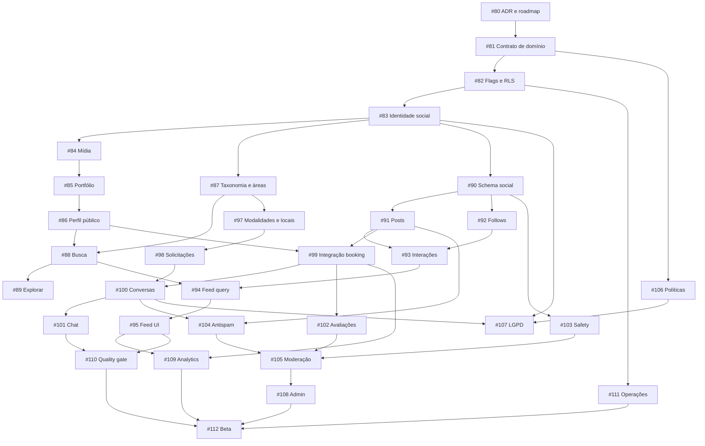

# Roadmap — Marcou Social

**Atualizado em:** 23/11/2026
**Roadmap no GitHub:** [Issue #72](https://github.com/deividjmoura/marcou/issues/72)
**Decisão arquitetural:** [DECISAO-ARQUITETURA-MARCOU-SOCIAL.md](DECISAO-ARQUITETURA-MARCOU-SOCIAL.md)
**Prompt para agentes:** [PROMPT-AGENTE-MARCOU-SOCIAL.md](PROMPT-AGENTE-MARCOU-SOCIAL.md)

## 1. Objetivo

Evoluir o Marcou para uma rede social centrada em serviços:

- profissionais publicam perfil, serviços, portfólio e posts;
- clientes descobrem, seguem, curtem, comentam, salvam e compartilham;
- o feed direciona para um serviço real, solicitação de orçamento ou
  agendamento;
- conversas, endereços e contratações permanecem privados e autorizados;
- avaliações derivam de contratações elegíveis;
- bloqueio, denúncia, antispam, moderação, LGPD e operação fazem parte do
  produto, não de uma etapa indefinida posterior.

A fundação técnica continua no Marcou. A Zelora é fonte de requisitos e regras de
marketplace; sua stack Firebase/Vite não será mesclada.

## 2. O que foi criado no GitHub

- **1 issue principal:** #72.
- **7 epics com hierarquia nativa de subissues:** #73 a #79.
- **33 leaf issues**, cada uma planejada para uma PR principal: #80 a #112.
- **6 milestones:** M0 a M5.
- **15 labels** para iniciativa, área, prioridade, epic, spike e bloqueio.
- Issues legadas relacionadas receberam `initiative:marcou-social`, sem mudança
  de milestone, corpo ou prioridade.

PRs vazias não foram abertas. Uma PR só deve existir quando houver diff real e
revisável; a árvore abaixo define as PRs que serão abertas durante a execução.

## 3. Árvore de issues

### Issue principal

- [#72 — Rede social de serviços integrada ao agendamento](https://github.com/deividjmoura/marcou/issues/72)

### Epics

1. [#73 — Fundação de produto e arquitetura](https://github.com/deividjmoura/marcou/issues/73)
2. [#74 — Identidade social, perfis, mídia e portfólio](https://github.com/deividjmoura/marcou/issues/74)
3. [#75 — Busca, descoberta e experiência pública](https://github.com/deividjmoura/marcou/issues/75)
4. [#76 — Conteúdo, grafo social, interações e feed](https://github.com/deividjmoura/marcou/issues/76)
5. [#77 — Serviços, solicitações, agendamento e conversas](https://github.com/deividjmoura/marcou/issues/77)
6. [#78 — Reputação, segurança, moderação e LGPD](https://github.com/deividjmoura/marcou/issues/78)
7. [#79 — Administração, qualidade, operação e beta](https://github.com/deividjmoura/marcou/issues/79)

## 4. Milestones e árvore de PRs

Cada linha abaixo representa **uma issue e uma PR principal planejada**. As epics
agregam trabalho e não devem receber uma PR monolítica.

### M0 — Fundação do Marcou Social

[Milestone](https://github.com/deividjmoura/marcou/milestone/1) · Epic
[#73](https://github.com/deividjmoura/marcou/issues/73)

| Issue | PR planejada | Dependências |
|---|---|---|
| [#80 — ADR e roadmap Zelora → Marcou](https://github.com/deividjmoura/marcou/issues/80) | `docs(social): define Zelora-to-Marcou roadmap` | base atual |
| [#81 — Contrato de domínio e eventos](https://github.com/deividjmoura/marcou/issues/81) | `docs(domain): define social and booking contracts` | #80, #21, #25 |
| [#82 — Schema, feature flags e baseline de RLS](https://github.com/deividjmoura/marcou/issues/82) | `test(security): establish social RLS and rollout baseline` | #81, #30, #31, PR #41 |

**Saída do milestone:** limites de domínio estáveis, estratégia de migration e
rollback, flags server-side e testes de isolamento prontos para os módulos.

### M1 — Perfis e descoberta

[Milestone](https://github.com/deividjmoura/marcou/milestone/2) · Epics
[#74](https://github.com/deividjmoura/marcou/issues/74) e
[#75](https://github.com/deividjmoura/marcou/issues/75)

| Issue | PR planejada | Dependências |
|---|---|---|
| [#83 — Papéis combináveis e perfil social](https://github.com/deividjmoura/marcou/issues/83) | `feat(identity): add combinable roles and social profiles` | #81, #82, #23, #43, #47 |
| [#84 — Pipeline seguro de mídia](https://github.com/deividjmoura/marcou/issues/84) | `feat(media): add secure social media pipeline` | #83, #82, #52, #53 |
| [#85 — Portfólio vinculado a serviços](https://github.com/deividjmoura/marcou/issues/85) | `feat(portfolio): add service-linked professional portfolios` | #83, #84, #52 |
| [#86 — Perfil profissional social](https://github.com/deividjmoura/marcou/issues/86) | `feat(profile): ship professional social profile and publishing flow` | #83–#85, #43, #54 |
| [#87 — Taxonomia, modalidades e áreas](https://github.com/deividjmoura/marcou/issues/87) | `feat(discovery): add taxonomy and privacy-safe service areas` | #81, #83 |
| [#88 — Busca indexada e ranking inicial](https://github.com/deividjmoura/marcou/issues/88) | `feat(search): add indexed provider and service discovery` | #83, #86, #87 |
| [#89 — Experiência Explorar/Buscar](https://github.com/deividjmoura/marcou/issues/89) | `feat(explore): add responsive discovery experience` | #86, #88, #27 |

**Saída do milestone:** profissional publica uma vitrine completa e cliente a
encontra por filtros úteis, sem exposição de endereço ou conteúdo privado.

### M2 — Conteúdo e feed

[Milestone](https://github.com/deividjmoura/marcou/milestone/3) · Epic
[#76](https://github.com/deividjmoura/marcou/issues/76)

| Issue | PR planejada | Dependências |
|---|---|---|
| [#90 — Schema social e RLS](https://github.com/deividjmoura/marcou/issues/90) | `feat(social): add social graph and content schema` | #81–#83 |
| [#91 — Publicação de posts](https://github.com/deividjmoura/marcou/issues/91) | `feat(posts): add service-linked post publishing` | #84, #85, #90 |
| [#92 — Follow graph](https://github.com/deividjmoura/marcou/issues/92) | `feat(follows): add follow graph and connection lists` | #83, #86, #90 |
| [#93 — Curtidas, comentários, salvos e share](https://github.com/deividjmoura/marcou/issues/93) | `feat(engagement): add likes comments saves and sharing` | #91, #92 |
| [#94 — Feed e paginação por cursor](https://github.com/deividjmoura/marcou/issues/94) | `feat(feed): add ranked cursor-paginated feed query` | #88, #91–#93 |
| [#95 — Interface do feed Início](https://github.com/deividjmoura/marcou/issues/95) | `feat(feed): build home feed experience` | #89, #94, #27 |
| [#96 — Notificações sociais](https://github.com/deividjmoura/marcou/issues/96) | `feat(notifications): add social event notifications` | #92, #93, #26 |

**Saída do milestone:** rede social funcional com publicação profissional,
grafo, interações, compartilhamento, feed resiliente e notificações sem spam.

### M3 — Contratação, conversas e reputação

[Milestone](https://github.com/deividjmoura/marcou/milestone/4) · Epic
[#77](https://github.com/deividjmoura/marcou/issues/77)

| Issue | PR planejada | Dependências |
|---|---|---|
| [#97 — Modalidades, orçamento e local privado](https://github.com/deividjmoura/marcou/issues/97) | `feat(services): add delivery modes and private service locations` | #81, #87, #24 |
| [#98 — Solicitações e contrapropostas](https://github.com/deividjmoura/marcou/issues/98) | `feat(requests): add quote and counterproposal workflow` | #82, #97, #25 |
| [#99 — CTA social → booking](https://github.com/deividjmoura/marcou/issues/99) | `feat(booking): connect social discovery to booking` | #86, #91, #97, #21, #22 |
| [#100 — Domínio de conversas](https://github.com/deividjmoura/marcou/issues/100) | `feat(messages): add authorized realtime conversation domain` | #82, #83, #98, #99 |
| [#101 — Interface de chat](https://github.com/deividjmoura/marcou/issues/101) | `feat(chat): build secure booking chat experience` | #84, #96, #100 |
| [#102 — Avaliações verificadas](https://github.com/deividjmoura/marcou/issues/102) | `feat(reviews): add verified mutual reviews and reputation` | #99, #25 |

**Saída do milestone:** conteúdo converte em booking real ou orçamento auditável;
chat é contextual e avaliações só nascem de contratação elegível.

### M4 — Confiança, moderação e LGPD

[Milestone](https://github.com/deividjmoura/marcou/milestone/5) · Epic
[#78](https://github.com/deividjmoura/marcou/issues/78)

| Issue | PR planejada | Dependências |
|---|---|---|
| [#103 — Bloquear, silenciar e denunciar](https://github.com/deividjmoura/marcou/issues/103) | `feat(safety): add block mute and report controls` | #83, #90 |
| [#104 — Rate limit, antispam e uploads](https://github.com/deividjmoura/marcou/issues/104) | `feat(abuse): add anti-spam and content upload protections` | #84, #91, #93, #100 |
| [#105 — Fluxo de moderação e sanções](https://github.com/deividjmoura/marcou/issues/105) | `feat(moderation): add moderation workflow and audit trail` | #102–#104 |
| [#106 — Políticas e consentimentos](https://github.com/deividjmoura/marcou/issues/106) | `feat(consent): version policies and community guidelines` | #80, #81 |
| [#107 — Direitos LGPD e retenção](https://github.com/deividjmoura/marcou/issues/107) | `feat(privacy): add LGPD data controls and retention` | #83, #100, #106 |

**Saída do milestone:** controles de segurança aplicados no servidor, moderação
operável, documentos coerentes e ciclo de vida de dados definido.

### M5 — Operação e beta

[Milestone](https://github.com/deividjmoura/marcou/milestone/6) · Epic
[#79](https://github.com/deividjmoura/marcou/issues/79)

| Issue | PR planejada | Dependências |
|---|---|---|
| [#108 — Painel administrativo](https://github.com/deividjmoura/marcou/issues/108) | `feat(admin): add trust and operations console` | #105 |
| [#109 — Analytics social → booking](https://github.com/deividjmoura/marcou/issues/109) | `feat(analytics): instrument social-to-booking funnel` | #95, #99, #102, #106 |
| [#110 — E2E, acessibilidade e performance](https://github.com/deividjmoura/marcou/issues/110) | `test(e2e): cover Marcou Social critical journeys` | #95, #99, #101, #102, #105, #31 |
| [#111 — Observabilidade, jobs e recuperação](https://github.com/deividjmoura/marcou/issues/111) | `chore(ops): add observability recovery and runbooks` | #82, #20, #26, #30 |
| [#112 — Rollout e piloto](https://github.com/deividjmoura/marcou/issues/112) | `feat(rollout): prepare staged Marcou Social beta` | #106–#111 |

**Saída do milestone:** beta limitado e reversível, com métricas, suporte,
moderação, testes, alertas, backups, restore e decisão go/no-go.

## 5. Grafo de dependências

O diagrama mostra os caminhos principais; os critérios completos estão nos
corpos das issues.

## 6. Ordem de execução e paralelismo

### Caminho crítico inicial

1. #80 — decisão e roadmap;
2. #81 — contrato detalhado;
3. #82 — migration/flags/RLS;
4. #83 — identidade social compatível;
5. depois disso, abrir frentes paralelas.

### Frentes paralelas seguras após #83

- **Perfil e mídia:** #84 → #85 → #86.
- **Taxonomia/descoberta:** #87; #88 aguarda #86 e #87.
- **Social data:** #90; depois #91 e #92 podem avançar em paralelo.
- **Políticas:** #106 pode avançar cedo, desde que reflita contratos reais e
  permaneça marcada como minuta quando necessário.

### Frentes posteriores

- #97 pode começar após #87 e não precisa esperar o feed.
- #103 pode começar após #90 e deve ser integrado a cada nova superfície.
- #96 pode avançar depois de follow/interações, em coordenação com #26.
- #111 pode preparar runbooks/observabilidade cedo, mas só fecha após os jobs e
  fluxos existirem.

### Evitar conflitos

- não executar #83, #90 e #97 simultaneamente sem acordo sobre migrations e
  contratos compartilhados;
- não alterar o widget/motor público em #99 antes de revisar #21, #22, #25 e PRs
  abertas relacionadas;
- não implementar uma segunda solução de mídia em #91/#101: ambos usam #84;
- não criar moderação apenas na interface: #103–#105 exigem enforcement no
  servidor/banco.

## 7. Relação com backlog existente

Estas issues não foram duplicadas nem movidas de milestone:

| Área | Issues existentes a revisar/reutilizar |
|---|---|
| Identidade e onboarding | #23, #43, #47 |
| Booking e ciclo de vida | #21, #22, #25 |
| Perfil e mídia | #52, #53, #54 |
| Painel e UX | #24, #27 |
| Notificações | #26 |
| Plataforma e qualidade | #20, #30, #31 |
| Integrações posteriores | #28, #29, #57 |

Antes de tocar áreas compartilhadas, revisar também as PRs abertas. Em
23/11/2026 havia trabalho concorrente de plataforma, notificações, agenda,
segurança, design, confirmação de reserva e autenticação. O estado do GitHub no
momento da implementação é a fonte de verdade; esta lista não substitui uma nova
inspeção.

## 8. Política das PRs

1. **Uma leaf issue = uma PR principal.** Se o diff ficar grande demais, criar
   subissue antes de fragmentar silenciosamente.
2. Epics e a issue #72 não recebem implementação monolítica.
3. Partir da `main` mais recente ou usar a branch fixa fornecida pelo ambiente;
   nunca trocar de branch quando a sessão do agente proibir.
4. Preferir PR independente contra `main`; usar PR empilhada somente quando a
   dependência for inseparável e estiver explicitamente documentada.
5. Incluir `Closes #N`, resumo, decisões, screenshots quando houver UI,
   migrations, riscos, rollback e testes realmente executados.
6. Não abrir PR vazia ou só com promessa de implementação.
7. Não misturar refactor amplo, redesign e alteração de domínio sem necessidade
   da issue.
8. Não aplicar migration nem alterar Supabase/Netlify/produção sem autorização.
9. Aguardar CI real; não declarar “verde” antes de os checks terminarem.

## 9. Definition of Ready

Uma issue está pronta para desenvolvimento quando:

- objetivo, escopo e critérios de aceite estão claros;
- dependências obrigatórias foram mergeadas ou há contrato estável explícito;
- conflito com PR aberta foi resolvido;
- decisões de produto necessárias foram registradas;
- migration/PII/RLS/rollback foram avaliados;
- um agente e uma branch estão atribuídos.

## 10. Definition of Done

Toda PR precisa, conforme o tipo de mudança:

- persistência e constraints coerentes;
- validação server-side;
- autorização/RLS e testes negativos multi-tenant;
- idempotência/concorrência em operações críticas;
- loading, vazio, erro, sucesso e retry na UI;
- responsividade, teclado, leitor de tela e `prefers-reduced-motion`;
- paginação e índices medidos para coleções crescentes;
- logs sem PII/conteúdo sensível;
- documentação, migrations e rollback atualizados;
- `npm run lint`, `npm run typecheck`, `npm run test`, `npm run test:db` e
  `npm run build`, quando aplicáveis;
- CI concluído com sucesso.

## 11. Gates do beta

O rollout #112 só pode avançar quando:

- perfil, busca, feed e CTA para booking funcionam em mobile/desktop;
- reserva direta continua protegida contra dupla marcação;
- solicitação/orçamento possui transições e histórico auditáveis;
- chat e endereço são acessíveis somente aos participantes corretos;
- avaliações exigem contratação elegível;
- bloqueio, denúncia, antispam e moderação estão operáveis;
- termos, privacidade, comunidade, retenção e direitos LGPD foram revisados;
- E2E crítico, acessibilidade, budgets, alertas, backup e restore têm evidência;
- feature flags e kill switch foram testados;
- produção só é alterada após autorização explícita e decisão go/no-go.

## 12. Itens deliberadamente posteriores

Não bloqueiam o primeiro beta social:

- app React Native/Expo;
- algoritmo de recomendação baseado em ML;
- publicidade ou destaque patrocinado;
- assinaturas Pro/Plus e cobrança recorrente;
- intermediação de pagamento do serviço;
- WhatsApp Business/bot e Google Calendar;
- publicação social pública de clientes;
- busca geoespacial precisa que exija localização sensível.

Esses itens exigem métricas do piloto, decisão comercial e, quando aplicável,
issues próprias antes de implementação.
